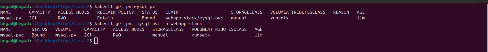
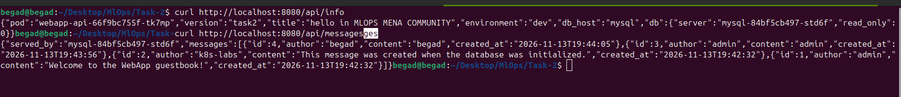
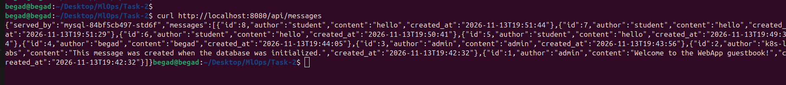
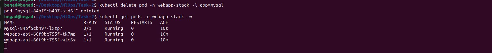

# Kubernetes Deployment Task 2: Execution & Verification

This document outlines the steps taken to deploy a FastAPI guestbook app backed by MySQL on Kubernetes, using persistent storage, a ConfigMap, a Secret and an Ingress.

## 1. Building and Deploying

First, I built the two images, loaded them into minikube, and applied the manifests in order (namespace, Secret, ConfigMap, PV/PVC, MySQL, app, Ingress). Below is the screenshot of the pods running successfully:

## 2. PV and PVC Binding

The PV (`mysql-pv`) is pinned to `minikube-m02` using node affinity, and the PVC (`mysql-pvc`) is bound to it:

## 3. Access Through the Ingress

I used port-forwarding to reach the Ingress Controller on `localhost:8080`.

**`/api/info`**: shows the values coming from the ConfigMap and the MySQL server the app is connected to:

**`/api/messages`**: shows the messages stored in MySQL:

## 4. Data Persistence Test

To verify that the data survives a restart, I first added a new message:

Then I deleted the MySQL Pod and waited for a new one to start:

The message is still there, so the data was kept on the PersistentVolume.
